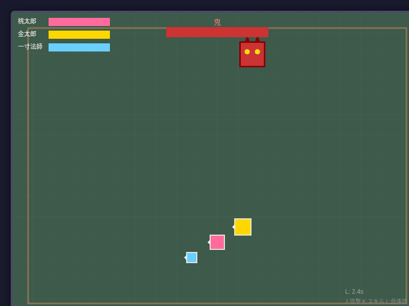

# mukashi-banashi-games

日本昔話をモチーフにしたゲームコレクション

## ブラウザで遊ぶ

**[昔話ゲーム集を開く](https://rsasaki0109.github.io/mukashi-banashi-games/)**

公開済みのブラウザ版：昔話パーティーバトル、花咲じいさん。ほかの3本はブラウザ版準備中です。

### GitHub Pages の初回設定

リポジトリの **Settings → Pages → Build and deployment → Source** を **GitHub Actions** に設定してください。その後 **Actions → Deploy GitHub Pages → Run workflow** を実行すると公開されます。以降は `main` への変更で自動更新されます。

公開対象はトップページと2本のブラウザゲームです。Unityのソースや未ビルドのテンプレートは配信しません。

## ゲーム一覧

### hanasaka_jisan_ash_game
花咲じいさんをモチーフにしたミニゲーム

[> 詳細](./hanasaka_jisan_ash_game/)

---

### issun_vs_oni
一寸法師 vs 鬼

[> 詳細](./issun_vs_oni/)

---

### kintaro_vs_bear_sumo
金太郎 vs 熊の相撲ゲーム

[> 詳細](./kintaro_vs_bear_sumo/)

---

### mukashi_party_battle
日本の童話キャラクターを操作するアクションゲーム

[> 詳細](./mukashi_party_battle/)

---

### tsuru_nozoku_na
「覗いてはいけない」を我慢するミニゲーム

[> 詳細](./tsuru_nozoku_na/)
